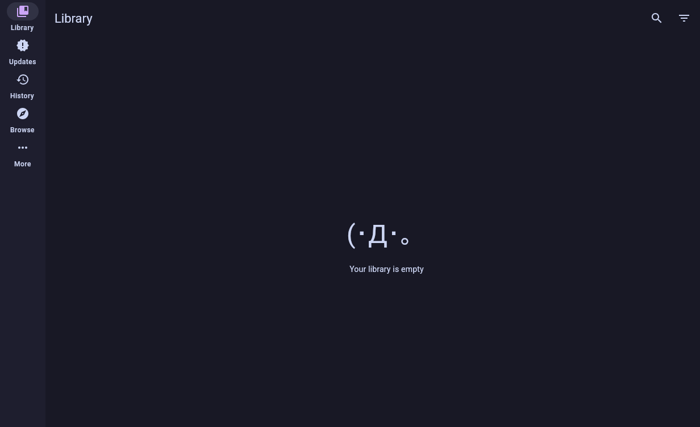

<div align="center">


# Inkoma

### Your manga library, on the big screen.

**Inkoma** (*ink* + *koma*, the panel of a manga page) is a free, open-source manga reader for **Linux, Windows and macOS**.
It runs the **same extensions as Mihon on Android**, so you can install a source, browse, download and read in one app.
No browser, no server, no setup.

[](../../actions/workflows/ci.yml)
[](../../releases/latest)
[](LICENSE)

**[⬇ Download](../../releases/latest)** · [Features](#features) · [Install](#install) · [Build from source](#build-from-source) · [Report a bug](../../issues/new/choose)



</div>

> Inkoma is an independent project built on [Mihon](https://github.com/mihonapp/mihon)'s open source code.
> It is not affiliated with or endorsed by the Mihon project.

## Why Inkoma

- **Your extensions just work.** Add an extension store and install sources exactly like on Android. Each APK is
  converted to run on the desktop and checked against the store's signing key.
- **Your library comes with you.** Backups use Mihon's `.tachibk` format, so you can move your library, categories and
  reading progress between your phone and your PC in both directions.
- **Made for a real screen.** Two-page spreads that follow the window shape, true fullscreen, keyboard shortcuts,
  mouse-wheel page turns and a two-pane manga page on wide windows.
- **Light on your machine.** About 130 MB of RAM when idle, under a second to start once warm, and a single ~80 MB download.

## Install

Grab the file for your system from the [latest release](../../releases/latest):

| System | File | How to run |
|---|---|---|
| **Linux** (x86_64) | `Inkoma-…-linux-x86_64.AppImage` | `chmod +x Inkoma-*.AppImage && ./Inkoma-*.AppImage` |
| **Windows** (64-bit) | `Inkoma-…-windows-x64.msi` or `…-windows-x64-portable.zip` | Run the installer, or unzip and start `Inkoma.exe` |
| **macOS** Apple Silicon / Intel | `Inkoma-…-macos-arm64.dmg` / `…-macos-x64.dmg` | Open the DMG and drag Inkoma to Applications |

Nothing else needs to be installed. The first-run setup helps you pick a theme and a download folder and add an extension store.

The builds are not code-signed yet:
- **Windows:** if SmartScreen says "Windows protected your PC", click **More info → Run anyway**.
- **macOS:** on first launch right-click the app → **Open**, or run
  `xattr -dr com.apple.quarantine "/Applications/Inkoma.app"`.

Linux needs glibc 2.17 or newer (Ubuntu 22.04, Linux Mint 21, Fedora, Debian 11 and later).

Data folders: Linux `~/.local/share/inkoma`, Windows `%APPDATA%\Inkoma`, macOS `~/Library/Application Support/Inkoma`.

## Features

**Everything you know from Mihon**
- Library with categories, filters, sorting and four display modes
- Browse sources, global search and filters; install, update, trust and remove extensions from extension stores
- Reader: paged left-to-right / right-to-left / vertical, webtoon and continuous vertical
- Updates, History, Downloads (CBZ or folders) and automatic library updates
- Backup and restore in Mihon's `.tachibk` format
- Local source (folders, CBZ/ZIP, EPUB)

**Built for the desktop**
- 📖 Two-page spread that follows the window: landscape shows two pages, portrait one big page
- 🖥️ True fullscreen (F11) with a hover bar to minimize, leave fullscreen or close
- ⌨️ Mouse wheel turns pages, Ctrl+wheel zooms, right click selects, and every keyboard shortcut can be changed
- 🎨 14 themes plus a custom colour, and colours taken from each cover
- ✨ Image quality and sharpening, filters (brightness, contrast, night tint, grayscale, invert) and a smart background
- 🧠 Automatic webtoon detection, maximum page width for ultrawide screens, per-series reader settings
- 🔔 Desktop notifications with cover art, grouped updates, source categories and HiDPI support

## Extensions

Inkoma ships no sources. Add an extension store in the first-run setup or under
Browse › Extensions › ⋮ › Extension stores, then install extensions as on Android.
Extensions are verified against the store's signing key before they are trusted.

Most extensions work. Sources that need Android's built-in WebView (for example MangaFire) cannot run on the desktop
and show a clear message instead.

## Build from source

Requirements: JDK 21.

```bash
./gradlew :app:run              # run from source
./gradlew :app:test             # run the tests
packaging/build-appimage.sh     # build dist/Inkoma-<version>-x86_64.AppImage
```

Releases are built by GitHub Actions on Linux, Windows and macOS: run the **Release** workflow from the Actions tab
to build, test and publish every installer. Locally, `./gradlew :app:packageMsi` (Windows)
and `./gradlew :app:packageDmg` (macOS) build the installer for the OS you are on.

## Stack (one line each)

| Choice | Why |
|---|---|
| **Kotlin/JVM** | Extensions are Dalvik bytecode compiled against a Kotlin/JVM API, so a JVM is the only runtime that can execute them without an Android emulator. |
| **Compose Multiplatform (Desktop) + Material 3** | It's the toolkit Mihon itself uses, so layouts, spacing and color tokens carry over 1:1. |
| **dex2jar** | It translates each extension's `classes*.dex` to JVM bytecode once at install time (Android loads dex directly). |
| **apk-parser** | It reads the binary `AndroidManifest.xml` metadata and the v1/v2 signing certificates that Mihon's trust model checks. |
| **SQLite (sqlite-jdbc)** | It's the same database engine as Android, with Mihon's schema, so there's no extra server or ORM. |
| **OkHttp 5 / Jsoup / RxJava 1 / kotlinx.serialization / Injekt** | These are exactly the libraries extensions expect the host to provide (versions match `keiyoushi/extensions-source`). |
| **Nashorn** | Backs `JavaScriptEngine` (QuickJS on Android), because some extensions evaluate JS. |
| **Own image loader instead of Coil** | Decoded-pixel budgets give tighter control over RSS (32 MB covers, 48 MB reader pages). |
| **jlink + AppCDS + SerialGC/C1** | The smallest JRE that works, with a sub-second warm start and a low steady-state footprint. |

## Repository layout

```
source-api/       Host API for extensions. Vendored verbatim from mihonapp/mihon (source-api + core/common network,
                  Apache-2.0), plus desktop shims: android.* / androidx.preference.* stubs, Injekt, NetworkHelper,
                  cookie jar, JavaScriptEngine.
app/              The application (data, extensions, downloads, library updates, backups, Compose UI).
  eu/kanade/tachiyomi/data/backup/models/   Mihon's protobuf backup models (same package, so serial names match).
test-extension/   Sample extension used by the integration test (dexed, translated and loaded like a real APK).
packaging/        AppImage build script, AppRun (JVM flags), desktop entry.
```

## Known differences from Android

* **No WebView.** "Open in WebView" opens the system browser, and Cloudflare-protected sources that need an interactive challenge won't work.
  Mihon's CloudflareInterceptor depends on Android's WebView, and bundling a browser engine would break the size budget.
* Local source supports folders, `.zip`/`.cbz` and `.epub`. It does not support `.rar`/`.cbr`/`.7z`, which would need native libarchive.
* Extensions that touch Android APIs beyond the provided stubs fail to load and show "Failed to load" with the error, as on Android.
  Provided stubs: `Context`/`SharedPreferences`, `Uri`, `Base64`, `Log`, `Html`, `TextUtils`, `Toast`, `Build`, `SystemClock`,
  `Bitmap`/`BitmapFactory`/`Canvas`/`Rect`/`Paint`, `EditText`, and `androidx.preference`.
* Navigation uses Mihon's large-screen layout (navigation rail) everywhere. Keyboard and mouse equivalents replace touch gestures (see Settings › Reader).

## Verification status

* `./gradlew :app:test` passes: extension pipeline, client contract (what Keiyoushi extensions assert about the default
  HTTP client), R8 constructor patterns (built, fixed, verified and executed), store index parsing (1556 extensions),
  two-page spread grouping.
* 45 real Keiyoushi extensions were converted with the app's converter and checked without executing their code:
  **45/45 pass the JVM bytecode verifier** (classes are linked, not initialised) and **41/45 resolve every referenced
  class, method and field**. The other 4 (MangaFire, AllAnime, LunarAnime, Comix) drive an Android WebView, which
  is not available on desktop; they report "needs a WebView" instead of crashing.
* Converter bugs found and fixed: dex2jar emitted frames with the nonexistent type `java/util/Object` and turned
  R8's "new T + superclass constructor" into `new S` ("Bad type on operand stack", "Bad <init> method call",
  "Call to wrong <init> method"). Frames are now recomputed against the real class hierarchy, the patched
  `NewTransformer` keeps the allocated type, and the constructors R8 removed are re-synthesized.
* The default HTTP client now matches Mihon's (Uncaught/UserAgent/Cloudflare interceptors, no Brotli network
  interceptor); extensions threw "must be present in default client" before.
* AppImage: Temurin runtime (natives need glibc ≤ 2.17), launched under Xvfb: first frame 1.4 s, RSS ≈ 130 MB, 78.3 MiB.

## Contributing

See [CONTRIBUTING.md](CONTRIBUTING.md). Bug reports with the exact error text help the most.

## License

[Apache License 2.0](LICENSE). Includes code from Mihon and Tachiyomi (Apache-2.0) and a modified dex2jar class
(Apache-2.0); bundles Roboto (SIL OFL 1.1). See [NOTICE](NOTICE).
